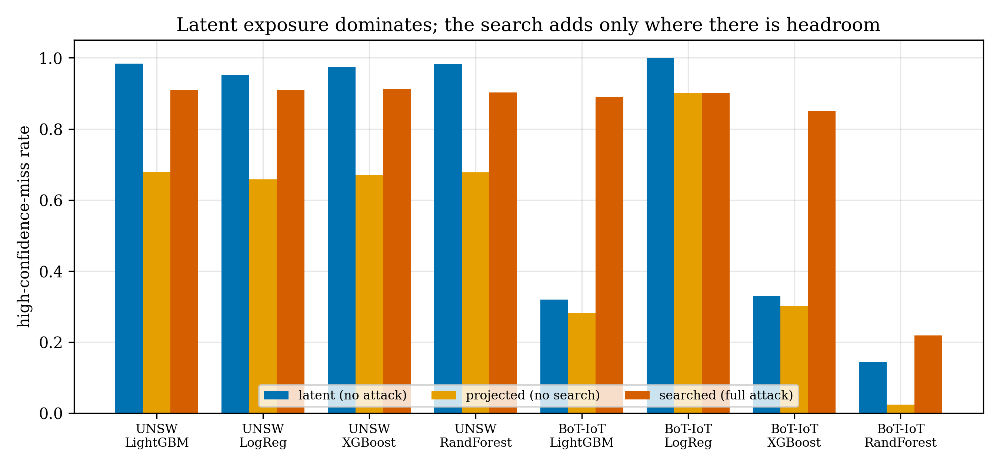
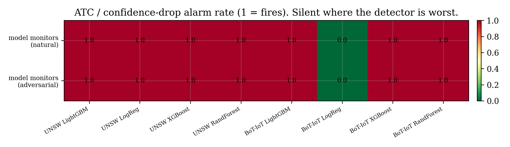
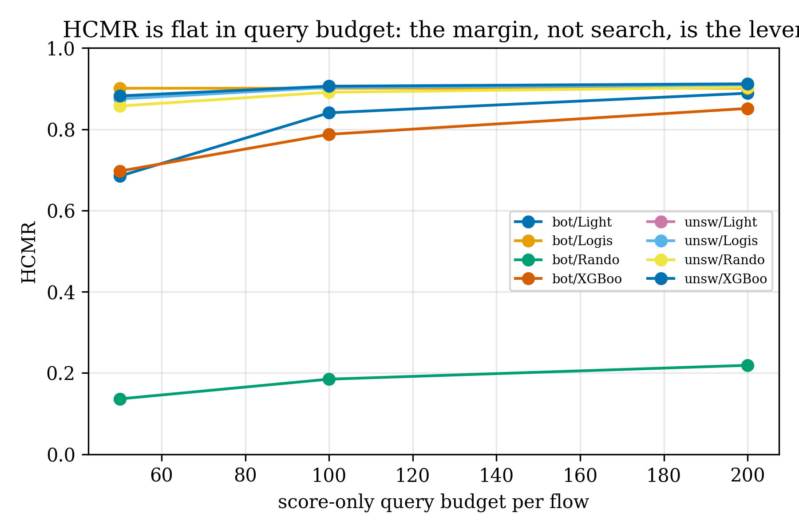
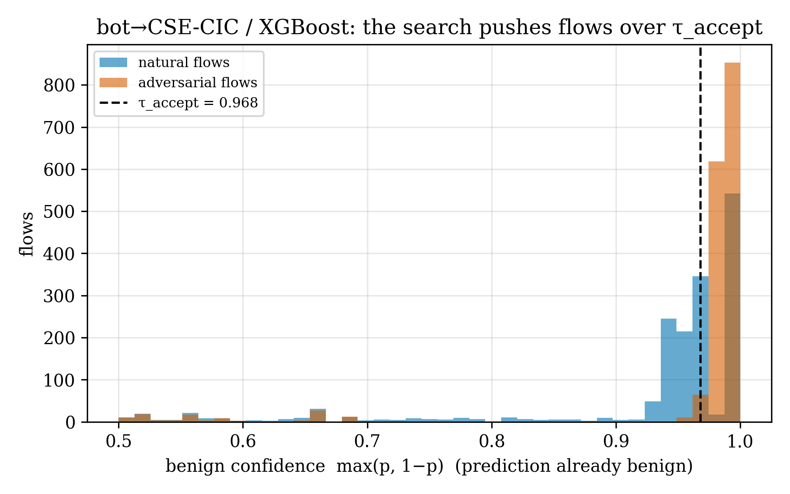
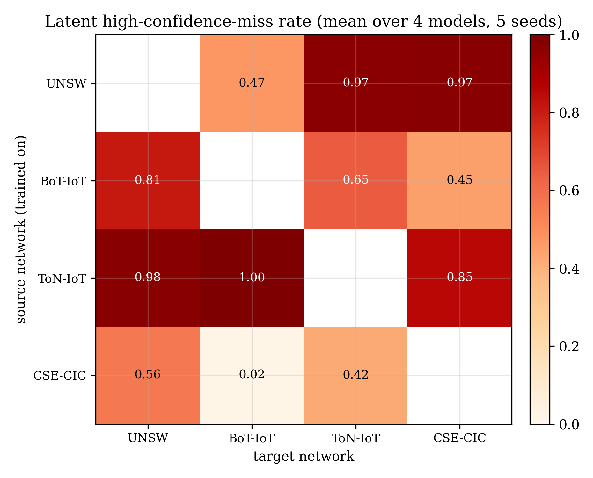
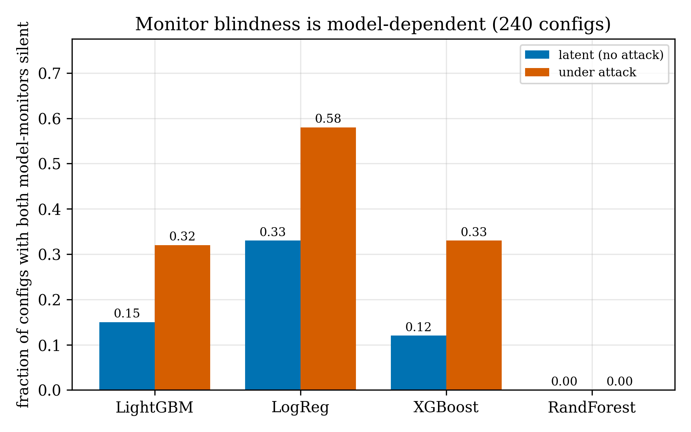

# A Shift Alarm Is Not a Safety Certificate: Recall Certification for Cross-Testbed Intrusion Detectors

*(working name: "Hiding in the Shift")*

**Rajveer Singh Pall** (sole author)

> Working manuscript, 2026-10-22. Full frozen specification (5 seeds, 200k/class source cap, 50k
> target benign, 2,000 target attack flows/family, 200-query score-only budget), NetFlow v2
> quartet. Every headline number is keyed to `results/p1/summary_p1.json` /
> `matrix_latent.json` and verified by `check_numbers_p1.py`. Scope is deliberately bounded:
> one feature family (NetFlow v2), feature-space attacks, no wire-realization claim. Language is
> sized to that evidence — "suggests", not "proves".

## Abstract

Flow-based DoS detectors score ~99% in-domain and collapse across independently captured networks;
operators are told to catch this with label-free monitors (Average Thresholded Confidence,
confidence drift, distribution distances) that need no target labels. Across the full NetFlow v2
quartet — 12 ordered source→target pairs, four detector families, five seeds, 240 configurations —
we measure what those monitors actually see. The dominant finding is not an attack: **before any
adversary acts, the cross-testbed detector already classifies a mean of 67.9% of real target DoS
flows (range 0–100%) as benign at high confidence**, the exact operating point the monitors
protect, and the model-based monitors stay silent on a large, systematic subset — **36 of 240
configurations, spanning nine distinct source→target→model combinations, pair high latent exposure
(>0.5) with both confidence monitors silent.** The blindness is model-dependent and aligns with
exposure: LogisticRegression is both the most exposed (mean latent 0.800) and the most frequently
silent (33%), while RandomForest is the least exposed (0.524) and never silent. A constrained,
score-only, traffic-plausible adversary adds capability only where the detector still has headroom
— its own contribution (searched minus projected high-confidence-miss rate) ranges from +0.607 to
+0.001 across cells and is ≈0 where the detector is already saturated; its power is not evasion
(nearly free) but confidence, moving flows across the auto-accept threshold. Run across the full
matrix, the adversary reaches a high-confidence-miss rate above 0.5 with both monitors silent in
**74 of 240 configurations (16 combinations)**, and in **51% of all successful attacks the monitors
report normal** — the dangerous pairing is a population property, worst for LogisticRegression
(silent 58%) and absent for RandomForest (0%). The obvious
responder-side defence — watch the features the adversary cannot freely set — fails a
pre-registered bar everywhere (ΔHCMR ≤ 0.072 against a 0.10 bar), because those features do not
transfer across independent testbeds either. The structural reason is known — Bikdeli et al. (2026)
formalise that a score-only monitor (ATC, confidence drift) can report perfect accuracy for a
zero-recall detector under benign shift — and our contribution on this point is to show an
*adversary* can deliberately drive flows into that blind spot across independent testbeds (on the
worst cell ATC reports 99.9% estimated accuracy while attack recall is 0%). The confidence monitors
we tested are recall-blind by construction; the distance monitors fire on any shift (non-specific);
a reliable drift alarm exists (Bikdeli's conformal abstention) but a drift alarm certifies *that*
something changed, not *that recall is acceptable*. The practical danger is
therefore not a clever adversary but a detector that is a thin margin from waving everything through
and a label-free safety net calibrated on the wrong network. The corollary is operational: since a
score-only monitor cannot certify recall, the minimal sufficient evidence is a *labelled* one. Using
a standard finite-sample recall audit (not a new estimator — the machinery is Clopper-Pearson /
prediction-powered risk monitoring), ten labelled **attack** examples — an attack-reference audit a
defender runs by replaying known or source attacks — cut the confidence monitors' empirical
false-certification rate from 15% to 0.03% on this benchmark. Scope and honesty: feature-space, one
NetFlow v2 family, the tested pairs; the recall-invisibility result and the audit are prior art
(Bikdeli et al. 2026; PPRM 2026; RiskGate-IDS 2026) — our distinct contribution is the *adversarial,
cross-testbed* measurement, the model-dependence, and the honest accounting of what certification
costs; "suggests", not "proves".

## 1. Introduction

Machine-learning network intrusion detectors report near-perfect in-domain scores and then
collapse when they are moved to an independently captured network. The prior study this work
builds on (P11, same repository) measured this for flow-based DoS/DDoS detection across the
NetFlow v2 quartet: in-domain macro-F1 ≈ 0.98, external ROC-AUC that falls below chance on
roughly half of the ordered dataset pairs, and a failure that is representational — the model
ranks attacks *below* benign traffic — rather than a merely stale threshold, for most pairs.

Because an operator cannot label traffic on the new network, the field's recommended safeguard is
**label-free monitoring**: estimate the deployed model's accuracy, or detect that the input
distribution has shifted, using only unlabeled target traffic. Average Thresholded Confidence
(ATC; Garg et al., ICLR 2022), confidence-drift signals, and distribution distances (A-distance,
MMD, per-feature Wasserstein) are the standard instruments. Bikdeli et al. (*The Dashboard Says
"Perfect"*, Frontiers in AI 2026) recently showed that this whole toolbox fails under a **benign**
one-year temporal drift between CIC-IDS2017 and CSE-CIC-IDS2018: no label-free selector or
test-time-adaptation variant beats the unadapted source model in both transfer directions.

This paper asks the adversarial and cross-testbed version of that question, and answers it
honestly — the answer is not the one the title of an attack paper would promise. We find that:

1. **The detector is already defeated at the monitored operating point.** Before any adversary
   acts, across the NetFlow v2 quartet the cross-testbed detector classifies a large and
   model-dependent fraction of *real* target DoS flows as benign **at high confidence** — the exact
   regime a confidence monitor is meant to protect. This latent exposure, not any attack, is the
   dominant phenomenon.
2. **The label-free monitors are model-dependently blind, and blindest where the detector is
   worst.** The model-based monitors (ATC, confidence drift) track the *natural* distribution
   shift, not the presence of high-confidence misses. For some detectors they fire (and would fire
   on benign drift anyway); for others — notably a low-capacity LogisticRegression on a
   strong-ranking transfer — they stay silent while essentially every target attack is a
   high-confidence miss.
3. **A constrained adversary widens the hole only where there is headroom.** An adversary limited
   to traffic-plausible, score-only feature changes raises the high-confidence-miss rate toward a
   feasibility ceiling where the detector still has headroom, and contributes essentially nothing
   where the detector is already saturated. Its power is not evasion (nearly free) but confidence:
   moving flows from the monitor's review region across the auto-accept threshold.
4. **The obvious responder-side defence does not transfer.** Watching the features the adversary
   cannot freely set does not close the gap at an acceptable false-alarm cost, because those
   features do not transfer across independent testbeds either.

The contribution is a measurement, under a pre-registered threat model and an apples-to-apples
baseline, of the **joint** object that the literature has only touched in pieces: adversarial and
latent high-confidence false negatives against the detector-plus-label-free-monitor system, under
cross-testbed shift, with a stated traffic-plausibility constraint model and a monitor-side defence
evaluated for both security gain and false-alarm cost.

## 2. Related work

We position against seven works (verified 2026-10-22; full URLs in the references). The novelty
gate was committed before any attack code (`PREREGISTRATION.md`).

- **Bikdeli et al., "The Dashboard Says 'Perfect'" (Frontiers in AI 2026)** — the closest work.
  It audits label-free monitors + test-time adaptation under a *benign* one-year temporal drift
  (CIC-IDS2017↔2018) and finds none beats the unadapted source in both directions. We add the
  *adversary* and the *independent-testbed* quartet, and we separate latent exposure from
  adversarial lift. Our delta: Bikdeli shows the monitors miss benign drift; we show they miss a
  detector that is already high-confidence wrong, and that an adversary can widen it under
  constraints.
- **Gnanaratna et al. (Kingston), SecureComm 2026** — hardens an uncertainty-aware deferral IDS
  against a *training-time* proxy adversary. There the monitor is the artefact being improved; here
  it is the artefact being probed, and we measure how many high-confidence misses survive it.
- **PANTS (Jin & Apostolaki, USENIX Security 2025)** — white-box realizable packet-level
  adversarial samples + adversarial training for traffic classifiers. Classifier-only; no
  confidence-monitor system and no cross-testbed-transfer framing. We borrow its constraint
  discipline, not its goal.
- **PAVE (protocol-validity-aware robustness evaluation, IoT NIDS, 2026)** — shows standard
  feature-space attacks are 0–3% valid on the wire. This is the principal threat to any
  feature-space claim; our constraint model (Merzouk's four criteria, §3) and our explicit refusal
  to claim wire-realizability are the direct answer.
- **Apruzzese et al. (DTRAP 2022)** and **Merzouk et al. (Annals of Telecommunications 2022)** —
  the realistic attacker-capability model and the four feature-validity criteria (value ranges,
  binary values, multiple-category membership, semantic relations) we adopt verbatim as our
  constraint specification.
- **elShehaby & Matrawy, SoK on evasion practicality (arXiv 2306.05494, v4 2025)** — argues many
  published NIDS evasions do not survive functionality/practicality checks, and dynamic detectors
  resist. Our honesty anchor: we report functional validity, and our headline is consistent with
  it — the practical danger is the detector's latent exposure, not a powerful evasion.
- **Garg et al., ATC (ICLR 2022)** — the monitor we probe. Its own theory notes that accuracy
  estimation under shift is as hard as finding the optimal predictor, hence rests on assumptions
  about the shift; our adversary and our cross-testbed setting break exactly those assumptions.

To our knowledge, no prior work measures adversarial high-confidence false negatives against the
joint detector-plus-label-free-monitor system under cross-testbed distribution shift and stated
traffic-plausibility constraints, together with a monitor-side defence evaluated for both security
gain and false-alarm cost.

**Risk monitoring with a label budget.** The certification corollary (§5.5) uses, rather than
invents, finite-sample risk monitoring: Podkopaev & Ramdas (2022) track a deployed model's risk and
detect harmful shift from a labelled stream; prediction-powered risk monitoring (Zhang et al., ICML
2026) corrects unlabelled predictions with a small labelled set under an anytime-valid bound; and
RiskGate-IDS (2026) calibrates a NetFlow detector to a target with a small labelled budget. Our gate
is the forced consequence of the recall-invisibility theorem — a labelled audit is *necessary*
because the score-only monitor is provably insufficient — and our contribution is that necessity and
the measured budget, not the audit estimator, which these works already provide. On attack realism,
PLAA (2026) demonstrates packet-level realizable evasion; we stay in feature space and do not claim
wire-realizability (PAVE).

## 3. Threat model and constraints

We instantiate Apruzzese's capability model and Merzouk's validity criteria; the full
specification is frozen in `PREREGISTRATION.md` §3.

**Goal.** Make a target-network DoS/DDoS flow be scored benign by the source-trained detector with
model confidence at or above an auto-acceptance threshold τ_accept, so a confidence/ATC monitor
does not escalate it.

**Knowledge.** Grey-box, **score-only** (the realistic default): the adversary knows the public
NetFlow v2 feature schema and can query the deployed model's score up to 200 times per flow, with
no gradients. A **strong** upper-bound search (larger budget + coordinate descent) stands in for a
white-box ablation; tree ensembles are non-differentiable, so we do not claim a gradient attack.

**Capability — three control classes** over the 39 shared NetFlow v2 features, derived from the
attack mechanism (not convenience) and frozen before any run:
- *Directly controllable* (16): source-side byte/packet counts, rates, durations, client TCP
  flags, packet-size features and bins.
- *Indirectly influenced* (13): responder-side bytes/packets, server flags, retransmissions, TCP
  windows — the attacker changes these only as a response, measured in §4.
- *Uncontrollable* (10): protocol identity, TTLs, DNS/ICMP/FTP fields — frozen at the original
  flow.

**Constraints (Merzouk's four criteria, made concrete).** (1) Box: each changed feature within the
empirical [p1, p99] range of real source attack flows of its family. (2) Immutability:
indirect and uncontrollable features frozen at the original flow. (3) Integer/flag: packet and
size-bin counts integral, flag bytes valid. (4) Dependency: mean packet length within [MIN,MAX],
bytes ≥ 20·packets, size-bin sum ≤ total packets, retransmissions ≤ totals. A projection operator
repairs any candidate into this set; a *functionality* test keeps the rate/volume features inside
the attack family's box so an evaded flow is still a working DoS.

**Success (high-confidence miss, HCM).** A flow is an HCM iff, after the source-fitted scaler and
threshold are applied on the target, it is predicted benign, its confidence max(p, 1−p) ≥ τ_accept
(set on source-validation benign at a 1% review budget), and it is feasible and functional. HCMR
is the fraction of target attack flows turned into an HCM within budget.

**Honest baseline.** Feasibility is an *attacker* constraint, not a validity test for real
wire-captured traffic. The latent HCM rate is therefore measured on the real target flows
**without** the source feasibility box; the adversarial lift is measured against the *projected*
real flow (same feasibility regime as the attack), never against the filtered natural rate. (An
earlier draft conflated the two; a correctness audit caught it and the comparison was fixed.)

## 4. Methods

All data loading, model fitting, and metrics reuse the P11 codebase (`src/`); P-1 code lives in
`research-opportunities/p1/` and never overwrites P11 artifacts. Leakage discipline is inherited:
scaler and median imputation are fit on source-train only, monitor and defence thresholds on
source-validation only, and target labels are used only to score. Data is loaded with a
memory-bounded streaming reader (pyarrow `iter_batches`, columns-only, two-pass per-class
Bernoulli downsample) so the 17–30M-row parquets never materialize; the ML logic is unchanged.

**Detectors.** Four families from the P11 pipeline — LightGBM, XGBoost, RandomForest,
LogisticRegression — each trained on a source domain (200k/class cap) and applied to the target
with a MinMax scaler, balanced sample weights, and a plateau-robust threshold.

**Controllability (Phase 1).** For each indirectly-influenced feature we fit a 5-fold
cross-validated predictor from the directly-controllable features on real flows and report R². A
low R² means the attacker cannot freely set that feature — the only features the Phase-4 defence
is permitted to watch, chosen on evidence rather than assumption. The result is that most
responder-side features are highly predictable from the attacker's direct choices (mean R² 0.84 on
UNSW-NB15, 0.78 on BoT-IoT): only `DST_TO_SRC_SECOND_BYTES` (R² 0.26 / 0.25) and, on BoT-IoT,
`RETRANSMITTED_OUT_BYTES` (0.20) and `RETRANSMITTED_OUT_PKTS` (0.39) fall below 0.5. The defence
therefore has thin material to watch — 1 low-controllability feature on UNSW-NB15 and 3 on BoT-IoT
— which foreshadows its failure in §5.4.

**Attack (Phase 3).** A constrained search over the directly-controllable features minimises the
detector's P(attack) subject to feasibility; because a low P(attack) simultaneously flips the
label and raises the benign confidence, one objective serves both halves of the HCM definition.
The search is batched (one model query scores all flows' current candidate), so the 200-query
budget is per flow. Indirect and uncontrollable features are frozen at the original flow — the
conservative attacker that cannot set the responder's behaviour, which is what gives a
responder-side monitor something to detect.

**Monitor battery (Phase 2).** Five label-free monitors from `src/divergence.py` — ATC estimated
accuracy, mean-confidence drop, KS on the score distribution, proxy A-distance, per-feature max
Wasserstein — each thresholded on a source-validation two-half null at the 1% false-alarm budget.
The identical battery is evaluated with no attack (baseline), during the attack, and across the
full transfer matrix.

**Defence (Phase 4).** An IsolationForest novelty score on the low-controllability features,
fitted on one half of source-validation benign and thresholded on the other half at the 1% budget.
A flagged flow is escalated and no longer counts as a successful miss. We report the drop in HCMR
and the added benign-review cost, and gate the defence on a pre-registered bar (ΔHCMR ≥ 0.10 at
added cost ≤ 0.02).

**Statistics.** HCMR and its components carry paired-bootstrap 95% CIs over flows (N ≥ 2000);
seed variance is reported separately across five seeds.

### 4.5 Why the model-based monitors are structurally blind (recall-invisibility)

The empirical silence of ATC and confidence-drift is not a calibration accident; it is forced by
what those monitors are functions of. **We claim no novelty for this observation:** Bikdeli et al.
(2026) already report that ATC assigns a predicted accuracy of 1.000 to a detector with zero recall
on every attack family under benign temporal shift, and formalise the inversion in two propositions.
We restate it in the form that makes the *adversarial* exploit explicit — the invariance is to any
relabelling that preserves the score distribution — and use it to explain the model-dependence; the
result below is theirs in substance, included for self-containedness.

Call a label-free monitor **score-only** if its output depends on the target deployment solely
through the empirical distribution of detector scores {p(x)} (equivalently of confidences
max(p, 1−p)). ATC, mean-confidence, mean-confidence-drop and the KS-on-scores test are score-only;
the feature-distribution monitors (proxy A-distance, Wasserstein) are not.

At an operational base rate π (attack fraction, with π ≪ 1 for a monitored network), a detector's
accuracy is (1−π)·specificity + π·recall ≈ specificity — it is dominated by benign traffic and is
almost independent of attack recall. ATC estimates accuracy, so it tracks specificity and is nearly
insensitive to recall.

> **Proposition (recall-invisibility; cf. Bikdeli et al. 2026, Props 1–2).** Let two target deployments D and D′ induce the *same*
> detector-score distribution, D with every attack flow in the high-score (attack) region and D′
> with the attack flows moved into the high-confidence low-score (benign) region. Any score-only
> monitor M satisfies M(D) = M(D′), while attack recall(D) = 1 and recall(D′) = 0.
>
> *Proof.* M depends on the deployment only through the score distribution, which is identical for D
> and D′ by construction, so M(D) = M(D′). Recall is the positive-class true-positive rate, a
> function of the joint distribution of (label, score); moving the attack class across the decision
> threshold while preserving the marginal score distribution changes recall from 1 to 0 without
> changing that marginal. ∎

A score-only monitor therefore cannot, in principle, distinguish a detector with full attack recall
from one with none when the two induce the same score distribution: its value is uninformative
about the quantity an operator cares about. Our adversary's task is exactly to realise D′ from D
under feasibility — to place attack flows in the detector's high-confidence-benign region R while
leaving the (benign-looking) score distribution intact. Whether R is feasibly reachable is
model-dependent and is what §5.3 measures (reachable under constraints for LogisticRegression and
the gradient-boosted models, not for RandomForest, whose R is small). **The blindness is structural
and universal; its exploitability is empirical and model-dependent.** Empirically, on the dangerous
BoT-IoT→CSE-CIC / LogisticRegression cell the adversarial deployment has **ATC-estimated accuracy
0.999 while attack recall is 0.000** (true accuracy 0.908, inflated by the benign base rate;
`results/p1/theory_illustration.json`, mean over 5 seeds) — the monitor reports "perfect" over a
detector that catches no attacks.

This also explains the dichotomy in §5.2: the feature-distribution monitors are *not* score-only
and can in principle see D′, but they fire on benign shift too (non-specific), so they raise no
actionable recall alarm either. The two monitor classes fail for complementary reasons — score-only
monitors are recall-blind by construction, feature monitors are recall-aware but not
recall-specific — which is why, across 240 configurations, neither is a usable cross-network recall
alarm.

## 5. Results

Numbers are keyed to `results/p1/summary_p1.json` (`matrix`, `per_pair_model`) and
`matrix_latent.json`; `check_numbers_p1.py` verifies them against this text.

We separate three tasks that the literature often conflates: **ranking quality** (can the detector
rank attacks above benign? — external AUC), **operating-point safety** (does it catch attacks at the
deployed threshold? — recall / high-confidence-miss rate), and **monitoring reliability** (do the
label-free signals reveal when the operating point is unsafe?). The paper's thesis is that these
come apart: a detector can rank well (AUC 0.919) yet be operating-point-unsafe (latent recall ≈ 0),
and the confidence monitors track neither — they track distribution movement. §5.1–5.2 establish the
first two tasks' divorce; §4.5 and §5.5 establish the third.

**Table 1.** The two representative pairs × four models (mean over 5 seeds). *lat* = latent
high-confidence-miss rate (no attack); *proj* = projected floor (project into the feasible box, no
search); *HCMR* = searched, with its mean per-seed bootstrap 95% CI (N ≥ 2000 over flows); *lift* =
HCMR − proj (the search's own contribution); *Pdrop* = mean per-flow drop in P(attack); *mon* = ATC
/ confidence-drop alarm during the attack (1 = fires); *def Δ* = defence HCMR reduction (bar 0.10).
Seed SD of HCMR is ≤ 0.011 except BoT-IoT/XGBoost (0.083) and BoT-IoT/RandomForest (0.074).

| source | model | ext AUC | lat | proj | HCMR [95% CI] | lift | Pdrop | mon | def Δ |
|---|---|---:|---:|---:|---:|---:|---:|---:|---:|
| UNSW | LightGBM | 0.236 | 0.984 | 0.679 | 0.910 [0.896, 0.924] | +0.232 | 0.010 | 1.0 | 0.072 |
| UNSW | LogisticRegression | 0.316 | 0.953 | 0.658 | 0.909 [0.895, 0.923] | +0.251 | 0.027 | 1.0 | 0.072 |
| UNSW | XGBoost | 0.158 | 0.974 | 0.670 | 0.912 [0.898, 0.926] | +0.242 | 0.028 | 1.0 | 0.072 |
| UNSW | RandomForest | 0.230 | 0.983 | 0.678 | 0.903 [0.889, 0.917] | +0.226 | 0.062 | 1.0 | 0.071 |
| BoT-IoT | LightGBM | 0.930 | 0.319 | 0.282 | 0.889 [0.874, 0.904] | +0.607 | 0.482 | 1.0 | 0.012 |
| BoT-IoT | LogisticRegression | 0.919 | 0.999 | 0.901 | 0.902 [0.887, 0.916] | +0.001 | 0.036 | **0.0** | 0.012 |
| BoT-IoT | XGBoost | 0.886 | 0.330 | 0.301 | 0.851 [0.835, 0.868] | +0.551 | 0.501 | 1.0 | 0.012 |
| BoT-IoT | RandomForest | 0.904 | 0.144 | 0.024 | 0.219 [0.200, 0.239] | +0.195 | 0.183 | 1.0 | 0.006 |

The one bold `mon` = 0.0 (BoT-IoT/LogisticRegression) is the dangerous cell: a strong-ranking
detector (AUC 0.919) with 99.9% latent high-confidence misses and a silent monitor. Note the two
regimes the `Pdrop` and `lift` columns reveal: on the *saturated* cells (all UNSW, and
BoT-IoT/LogReg) the search barely moves P(attack) (Pdrop ≤ 0.062) and latent exposure does the
work; on the *headroom* cells (BoT-IoT/LightGBM, XGBoost) the search does substantial,
feasibility-bounded work (Pdrop ≈ 0.48–0.50, lift +0.55 to +0.61) and the adversary, not latent
exposure, dominates there.

### 5.1 Latent high-confidence exposure is pervasive across the quartet

Across the full NetFlow v2 transfer matrix — 12 ordered pairs × 4 models × 5 seeds, 240
configurations, every target carrying volumetric DoS flows — the **mean latent high-confidence-miss
rate is 0.679**, ranging from 0.0 to 1.0. Before any adversary, a cross-testbed DoS detector on
average already assigns benign-at-high-confidence to two thirds of real target attack flows. This
is not confined to the pairs where ranking inverts: on the strong-ranking BoT-IoT→CSE-CIC pair
(external AUC 0.89–0.93) the latent rate still reaches 0.999 for LogisticRegression, driven by
threshold-loss and overconfidence rather than ranking collapse. The exposure is strongly
model-dependent (per-model mean latent: LogisticRegression 0.800, LightGBM 0.707, XGBoost 0.685,
RandomForest 0.524). Figure 1 shows the decomposition on the two representative pairs.

### 5.2 The label-free monitors are model-dependently blind — and blindest where exposure is worst

The model-based monitors fire at a mean rate of 0.80 (ATC) and 0.80 (confidence drop) across the
matrix — but their alarm tracks the *natural* distribution shift, not the presence of
high-confidence misses. The dangerous regime is a monitor that stays silent while the detector is
wide open: **36 of 240 configurations have latent HCMR > 0.5 with both model-based monitors
silent, spanning nine distinct source→target→model combinations** (e.g. BoT-IoT→CSE-CIC/LogReg,
ToN-IoT→BoT-IoT/{LightGBM,LogReg,XGBoost}, ToN-IoT→CSE-CIC/LogReg, UNSW→ToN-IoT/LogReg). The
blindness aligns with exposure by model: LogisticRegression is silent at a rate of 0.33 (33% of
its configurations, and is the most exposed), whereas RandomForest is **never** silent (and is the
least exposed).
Figure 2 is the alarm heatmap on the representative pairs. For an operator this is the worst
possible pairing — the monitor is quietest exactly where the detector has already failed.

### 5.3 The adversary buys confidence, not evasion, and only where there is headroom

On the two representative pairs (UNSW-NB15, BoT-IoT → CSE-CIC-IDS2018) × 4 models we run the full
score-only search and decompose the high-confidence-miss rate into latent (real flows, no attacker
box), projected (project into the box, no search) and searched (full attack). The search's own
contribution (searched − projected) is **+0.607 (BoT/LightGBM), +0.551 (BoT/XGBoost), +0.251
(UNSW/LogReg), +0.232 (UNSW/LightGBM), +0.242 (UNSW/XGBoost), +0.226 (UNSW/RandomForest), +0.195
(BoT/RandomForest), and +0.001 (BoT/LogReg)**: the adversary widens the hole where the detector has
headroom and adds essentially nothing where it is already saturated (BoT/LogReg, latent 0.999).
One model resists outright: on BoT-IoT→CSE-CIC, **RandomForest holds the searched HCMR to 0.219**
(latent 0.144, strong-search 0.268) — its coarse, less-overconfident probabilities keep most
feasible flows below the auto-accept threshold. The effort the search spends is sharply two-regime
(Table 1, `Pdrop`): on the saturated cells (all UNSW, BoT-IoT/LogReg) the per-flow P(attack) drop is
small (0.010–0.062) — the flows begin a thin margin below τ_accept and a feasible nudge carries
them over, so latent exposure, not the search, dominates. On the headroom cells
(BoT-IoT/LightGBM, XGBoost) the drop is large (0.482, 0.501) and the search does substantial,
feasibility-bounded work; there the adversary dominates and the latent rate alone understates the
risk. The strong upper-bound search accordingly adds little on the saturated cells (≤ 0.012) but up
to +0.047 (XGBoost) and +0.049 (RandomForest) on BoT-IoT, so the score-only-versus-white-box
distinction matters for the headroom cells even though it leaves the dangerous BoT-IoT/LogReg cell
unchanged. The query budget shows the same split: HCMR for BoT-IoT/LightGBM rises from 0.685 at 50
queries to 0.889 at 200 and for XGBoost from 0.697 to 0.851, while it is flat for LogisticRegression
(≈0.902, saturated) and stays low for RandomForest (0.136→0.219) regardless of budget (Figure 3).
Figure 4 shows the mechanism on a headroom cell — the search concentrates the benign-confidence
distribution across τ_accept. Robustness to the operating point: at a stricter 5% benign-review
budget (a higher τ_accept), HCMR falls on the headroom cells (BoT-IoT/LightGBM 0.889→0.314,
RandomForest 0.219→0.011) but is **unchanged on the dangerous BoT-IoT/LogReg cell (0.902→0.902)**,
whose misses sit at confidence ≈ 1.0 — tightening the monitor cannot recover the cell where it is
already blind.

**The adversarial quiet-monitor failure generalises across the quartet.** Running the score-only
search over the *full* transfer matrix (all 12 ordered pairs × 4 models × 5 seeds, 240
configurations; mean searched HCMR 0.578) and scoring the model-based monitors during each attack,
**74 of 240 configurations — 16 distinct source→target→model combinations — pair an adversarial HCMR
above 0.5 with both confidence monitors silent.** Of the 145 configurations where the adversary
reaches HCMR > 0.5, **51% have both monitors silent**: roughly half the time an adversary succeeds,
the label-free confidence monitors report normal. The model ordering from §5.2 holds under attack:
LogisticRegression is silent in 58% of its configurations (mean searched HCMR 0.700), XGBoost 33%
(0.604), LightGBM 32% (0.587), and RandomForest **0%** — it is never silent and the search reaches
only 0.419 on it. So the dangerous pairing is not the single cell of Table 1 but a population
property of the quartet, concentrated on the lower-capacity and gradient-boosted detectors.

### 5.4 The obvious responder-side defence does not transfer

The pre-registered Gate 3 asked for non-trivial HCMR *and* silent model-based monitors on at least
one pair before proceeding to a defence; aggregated to the pair level it reads false (the monitors
fire for three of four models). The quiet-monitor world exists at the *cell* level —
BoT-IoT/LogisticRegression — so we run the defence there and report it as a pre-registered negative
rather than suppress it.

A novelty monitor on the low-controllability features (the only ones the attacker cannot freely
set; Phase 1 found just 1–3 per source) **fails the pre-registered bar everywhere**: it cuts HCMR
by 0.072 (UNSW pairs) and 0.012 (BoT-IoT pairs) against a 0.10 bar, catching ≤ 8% of misses at
≤ 1.0% added benign-review cost. The reason is P11's reason: across independently built testbeds
the low-controllability features do not transfer either, so a source-fitted novelty detector on
them cannot separate an adversarial target flow from benign target traffic. We report this negative
as a result, not a footnote.

### Figures

**Figure 1.** Latent / projected / searched high-confidence-miss rate for the two representative
pairs × four models. Latent exposure (blue) dominates; the search (orange) adds only where the
detector has headroom, and RandomForest on BoT-IoT resists outright.

**Figure 2.** ATC / confidence-drop alarm rate (1 = fires). The monitors are silent (green) only on
BoT-IoT→CSE-CIC / LogisticRegression — the cell where the detector is already fully exposed.

**Figure 3.** HCMR vs score-only query budget. More queries help only where the detector has
headroom (BoT-IoT/LightGBM, XGBoost); flat where saturated (BoT-IoT/LogReg) or where the model
resists (BoT-IoT/RandomForest).

**Figure 4.** Mechanism (BoT-IoT→CSE-CIC / XGBoost, τ_accept = 0.968). Natural flows (blue) sit
just below the auto-accept threshold; the search shifts them (orange) across it — the adversary
buys confidence, not evasion.

**Figure 5.** Latent high-confidence-miss rate across the full NetFlow v2 transfer matrix (mean
over 4 models, 5 seeds). Exposure is high on 8 of 12 ordered pairs (0.56–1.00), moderate on three
(0.42–0.47), and near-zero on CSE-CIC→BoT-IoT (0.02); the phenomenon is not confined to the two
attacked pairs, but it is also not universal.

**Figure 6.** Fraction of the 240 configurations in which both model-based monitors are silent, per
detector, with no attack (latent) and under the score-only attack. The blindness is
model-dependent and persists under attack — worst for LogisticRegression (0.33 → 0.58), absent for
RandomForest (0.00 / 0.00).

### 5.5 What evidence certifies recall: a small labelled audit

The recall-invisibility proposition (§4.5) has an operational corollary: since no score-only monitor
can certify attack recall, the minimal sufficient evidence is a *labelled* one — a budgeted audit of
target flows. We do not propose a new estimator; finite-sample risk monitoring with a trickle of
labels is established (Podkopaev & Ramdas 2022; prediction-powered risk monitoring, Zhang et al.
2026; budgeted target calibration for NIDS, RiskGate-IDS 2026). We instead measure, on the full
240-config matrix, what that evidence buys against the confidence monitors it replaces.

**Sampling design (stated, because it bounds the claim).** The audit draws **k labelled *attack*
examples** and forms a Clopper-Pearson lower bound on recall. This is an *attack-reference* (active)
audit: it assumes the auditor can produce known attacks — replay the source-network attacks the
detector was trained on, a red-team, or honeypot captures — which is realistic for a defender who
already holds source attacks, and it certifies recall **against that reference attack distribution,
not against unknown attacks**. It does *not* assume free labels for target-native attacks. If labels
instead come from passively labelling random target traffic at base rate π, observing k attacks
costs ≈ k/π labels (e.g. 100, 1 000, 10 000 random labels for k = 10 at π = 0.1, 0.01, 0.001;
`results/p1/riskgate_realistic.json`). The gate's *verdicts* are unchanged either way — only the
label cost differs.

**Passive sampling, validated (not just the k/π estimate).** Simulating random target labelling
(`results/p1/audit_passive.json`) confirms passive auditing is expensive and often infeasible at low
base rates: at π = 0.1 a 100-label budget fails to yield 10 attacks 45% of the time; at π = 0.01 a
100-label budget *never* reaches 10 attacks and a 1 000-label budget fails 46% of the time; at
π = 0.001 even 1 000 labels never suffice. And a further honest limit: **ten labelled attacks
certify a detector *unsafe* easily but can only certify it *safe* if 9 of the 10 are caught** (the
one-sided Clopper-Pearson recall lower bound is 0.606 at 9/10, 0.493 at 8/10). Because 227/240 of our
configurations are deeply unsafe (mean recall 0.086), the audit's job here is overwhelmingly correct
*escalation*, not safe-certification — the "ten flows" result is a cheap way to *catch* a broken
detector, not a cheap safety certificate. We state this rather than imply the audit certifies safety
for free.

Treat a configuration as *unsafe* if the detector's true attack recall at its deployed threshold is
below 0.5 (227 of 240 configs are unsafe — mean recall 0.086, and 80% of configs catch under 10% of
attacks, so most are easy to expose). A gate that trusts the **score-only** confidence monitors
(accept when neither ATC nor confidence-drift fires) accepts **15.0% of configurations that are in
fact unsafe**. The attack-reference audit (accept if the Clopper-Pearson recall lower bound clears
0.5, escalate if the upper bound falls below it, else *insufficient evidence*) accepts an unsafe
config in **0.03% of simulated audits at k = 10** (coverage 0.81, 86% of unsafe configs escalated;
k = 50: coverage 0.90, 95% escalated; `results/p1/riskgate_pilot.json`). **Statistical meaning:**
0.03% is the *empirical* false-certification frequency over simulated audit draws on this benchmark;
*per configuration*, the one-sided test's false-accept probability is controlled at the nominal α by
the Clopper-Pearson construction, and the empirical rate is far below α only because most detectors
are deeply unsafe (recall ≈ 0), which few attack labels expose. This is consistent with P11 (F7: ten
labelled target flows beat every zero-label method). We present the gate not as a new estimator but
as the honest *cost of certification* once §4.5 rules the confidence monitors out; its third
verdict, *insufficient evidence*, is the output the confidence monitors never give.

### 5.6 Sequential auditing, and why the obvious baselines do not certify recall

**Sequential audit.** Fixing the budget wastes labels on easy configurations. A sequential gate that
applies the Clopper-Pearson test at a geometric checkpoint schedule (10, 20, …, 320), with the
error budget split across checkpoints so the guarantee holds at each, reaches the same coverage
(0.94) as the fixed k = 250 audit at a **mean of 39 labelled flows and a median of 10**
(`results/p1/riskgate.json`): most configurations are decided at the first checkpoint, and only
those with true recall near the 0.5 floor need more. The certification cost is therefore a few dozen
labels on average, not hundreds.

**Baselines.** Two standard responses do not certify recall, for structural reasons that §4.5
predicts:

| method | label cost | certifies recall? | why |
|---|---|---|---|
| Confidence monitors (ATC, drift) | 0 | **no** | score-only ⇒ recall-invisible (§4.5); false assurance on 15% of configs |
| Prediction-powered risk monitoring (PPRM-style) | a trickle | **no** | estimates a base-rate-weighted *overall* risk; at a NIDS base rate that risk ≈ specificity and is recall-blind — on the dangerous cell it reads error ≈ 0.092 while recall is 0. Pointed at recall it needs the labelled audit, and prediction-powering buys nothing because the model's predictions on the attack subpopulation are, by hypothesis, the collapsed quantity |
| Threshold recalibration (benign-quantile) | 0 | **no** | label-free, so provides no recall guarantee; it only trades the operating point, and on transfers where ranking inverts it does not restore recall (P11 F6: recovers 97% of the headroom on the one ranking-preserving pair, actively harmful on three others) |
| Conformal abstention (Bikdeli et al. 2026) | 0 | **no** | Bikdeli report it as a reliable *drift* alarm under benign temporal shift. We ran an **approximate** reproduction on our matrix: it is non-specific here (alarms on 0.92 of *safe* vs 0.84 of unsafe configs, gap −0.09) and — decisively — silent on **75% of the 36 dangerous cells** (unsafe + confidence-monitors-silent), because those misses are *confident* (low nonconformity) and a score-functional abstention shares the recall-invisibility. Caveat: approximate implementation, and our adversarial cross-testbed setting differs from their benign-temporal one |
| **Labelled recall audit (fixed / sequential)** | 10–40 **attack** labels (or ≈k/π random labels) | **yes** | directly bounds the quantity of interest with a finite-sample interval; needs an attack-reference sample (§5.5) |

The point is not that the audit is a new estimator — it is textbook — but that it is the *only* one
of these four that answers the certification question, and the recall-invisibility proposition
(§4.5) explains why the cheaper three cannot. The sophistication of a monitor (PPRM's anytime-valid
machinery over the confidence/loss distribution) does not rescue it: a more powerful estimator of a
recall-blind estimand is still recall-blind.

## 6. Discussion

The uncomfortable alignment in §5.2 is the paper's core message for practice. Label-free
confidence monitors do not fail randomly across detectors; they fail *systematically* on the
detectors that are already most exposed. A low-capacity, well-calibrated-looking model
(LogisticRegression) that transfers "well" by AUC can still assign benign-at-high-confidence to
almost every target attack, and precisely because its confidence distribution shifts little between
source and target, ATC and confidence-drift report normal. A monitor that measures how much the
model's own confidence moved cannot, in principle, see a failure that does not move it. This is the
adversarial, cross-testbed sharpening of Bikdeli et al.: not only does the toolbox miss benign
drift, it misses a detector that is confidently wrong, and an adversary can deliberately keep flows
inside the region it trusts.

RandomForest's resistance is informative rather than a fix. Its probabilities are coarse (fractions
of trees), so fewer feasible flows clear a high τ_accept, and its latent exposure is lowest. But it
is never the operator's only model, its in-domain scores are indistinguishable from the others, and
nothing at deployment tells an operator which model they have drawn. The lesson is not "use
RandomForest" but "a label-free confidence monitor is not a safety net you can rely on across
networks, and the obvious responder-side patch does not survive the move." This is consistent with
the evasion-practicality SoK: the practical danger here is not a powerful evasion but a detector a
thin margin from waving everything through. Ten labelled target flows (P11, F7) remain worth more
than any zero-label monitor in this setting.

**Positioning.** This paper is one instance of a single question: *does a reported evaluation
metric justify the conclusion drawn from it?* The recall-invisibility result (§4.5) is the sharp
form here — a label-free "accuracy" estimate can read 0.999 over a detector that catches no attacks,
because accuracy at an operational base rate is the wrong quantity and a score-only monitor can
only estimate quantities of that kind. The same failure recurs across settings with different
metrics: an in-domain accuracy that does not survive a change of network (P11); a leaderboard
ordering that reverses when the answer-verifier changes (P14); a benchmark score that flips between
strict and judge-corrected scoring (P5); a pooled AUC that improves while a subgroup's
capacity-threshold flagging worsens (P06b); and finite-sample validity bounds for exactly these
label-free monitors (the author's concurrent work). P-1 adds the adversarial and security instance:
not only is the reported monitor uninformative under benign shift (Bikdeli), it is adversarially
controllable, and we characterise when (reachability of the high-confidence-benign region) and why
(the recall-invisibility proposition). The through-line is a programme on when measurement licenses
a safety claim, and when it does not.

## 7. Limitations

**Evidence base.** Both the latent result (§5.1–5.2, 240 configs) and the adversarial
quiet-monitor result (§5.3, 240 configs: 74/240 dangerous cells across 16 combinations) are
measured across the full 12-pair quartet. The **detailed per-cell decomposition — latent /
projected / searched with bootstrap CIs, the τ-sensitivity, and the defence (§5.3–5.4, Table 1) —
is the two-source (UNSW-NB15, BoT-IoT) → one common target (CSE-CIC-IDS2018) set**, four models,
five seeds, because the lift decomposition and the defence require the per-source feasibility box
and controllability analysis. So the generality of the phenomenon rests on 240 configurations; the
mechanism and the defence evaluation rest on the two-pair detailed study.

One feature family (NetFlow v2); both attacked sources carry a single DoS family (volumetric), so
the per-family box is one family's. The main study is feature-space; no wire-realizability is
claimed — the optional single-family wire check (Phase 1-R) was not run, so the realism argument
rests on the constraint model and the controllability analysis, not on re-extracted flows. The
strong search is an upper bound, not a gradient attack, and it matters: it raises HCMR by up to
+0.049 over score-only on the BoT-IoT headroom cells (§5.3). **External AUCs differ materially from
P11's** — e.g. UNSW→CSE-CIC/LightGBM is 0.236 here against P11's 0.0697, and BoT-IoT→CSE-CIC 0.930
against 0.966 — because of a different sampling cap and a volumetric-only target; the inversion is
therefore less extreme in our sample, and these AUCs are internal context, not comparable to P11's
full-pipeline numbers. The findings are a measurement for the tested system, not a general claim
about all NIDS or all monitors. The recall-invisibility proposition (§4.5) is exact for two
deployments with identical score distributions; a real adversary matches the source score
distribution only approximately (hence the empirical ATC gap is small but nonzero), and the
proposition's precondition — feasible reachability of the high-confidence-benign region — is the
model-dependent quantity the empirical study measures, not an assumption. The 240
configurations are **not** 240 independent environments: they are 12 ordered pairs × 4 models × 5
seeds, and configurations sharing a pair or a model are correlated. We therefore report per-pair and
per-model breakdowns throughout and read the aggregate counts (e.g. 74/240) as descriptive of this
design, not as a sample of independent deployments. The **recall audit assumes an attack-reference
sample** (§5.5): it certifies recall against attacks the auditor can produce, not unknown zero-days,
and passive labelling is expensive at low base rates — the gate is a *cost-of-certification*
statement, not a claim that recall is cheap to certify in all deployments. Finally, we ran an **approximate**
reproduction of Bikdeli et al.'s conformal-abstention drift signal (§5.6): in our adversarial
cross-testbed setting it was non-specific (alarm 0.92 on safe vs 0.84 on unsafe) and silent on 75% of
the dangerous confident-miss cells. We flag this as approximate — not a faithful reproduction of
their pipeline, and their benign-temporal setting differs — so it bounds, rather than refutes,
their finding; a verbatim reproduction remains untested.

## 8. Ethics and responsible disclosure

This is defensive security research under the standard adversarial-ML evaluation paradigm (Carlini
et al. 2019; Apruzzese et al. 2022; PANTS 2025). The author red-teams **his own** detector, trained
on public, offline, already-held datasets, to measure a blind spot in its label-free monitoring
and then test a monitor-side defence. No third-party or production system is probed; all traffic
manipulation is synthetic and confined to local feature-space datasets. No pcaps are produced and
no wire-realizable exploit is released. The attack code is kept in a private repository until the
paper is public.

## 9. Reproducibility

Every figure and table regenerates from a `results/p1/*.json` file; every headline number is pinned
to a key in `summary_p1.json` and checked by `check_numbers_p1.py`. Seeds are fixed (42–46);
configurations are at the top of each entry point. The pre-registration (threat model, frozen
choices, success definition, falsifiers) was committed before any attack code, with dated
amendments for the pilot-vs-full scale, the strong-search ablation, and the memory-bounded loader.

## References

1. Bikdeli et al. *The Dashboard Says "Perfect": A Systematic Audit of Label-Free Model Monitoring
   and Test-Time Adaptation Under Temporal Distribution Shift in Network Intrusion Detection.*
   Frontiers in Artificial Intelligence, 2026. DOI 10.3389/frai.2026.1928858.
2. K. Gnanaratna, J.-C. Nebel, F. Rahman, O. Omego. *Adaptive and Uncertainty-Aware Intrusion
   Detection with Hybrid Meta-learning Under Proxy-Adversarial Exposure.* SecureComm 2026, LNICST
   vol. 705, pp. 74–88. Springer.
3. M. Jin, M. Apostolaki. *Robustifying ML-powered Network Classifiers with PANTS.* 34th USENIX
   Security Symposium, 2025. arXiv:2409.04691.
4. *PAVE: A protocol-validity-aware framework for adversarial robustness evaluation of
   deep-learning intrusion detection in IoT networks.* ScienceDirect, 2026 (pii
   S2667295226000450).
5. G. Apruzzese et al. *Modeling Realistic Adversarial Attacks against Network Intrusion Detection
   Systems.* ACM DTRAP 3(3):31, 2022. arXiv:2106.09380.
6. M. A. Merzouk, F. Cuppens, N. Boulahia-Cuppens, R. Yaich. *Investigating the practicality of
   adversarial evasion attacks on network intrusion detection.* Annals of Telecommunications 77,
   763–775, 2022. DOI 10.1007/s12243-022-00910-1.
7. M. elShehaby, A. Matrawy. *Evasion Adversarial Attacks Remain Impractical Against ML-based
   Network Intrusion Detection Systems, Especially Dynamic Ones (SoK).* arXiv:2306.05494, v4 2025.
8. S. Garg, S. Balakrishnan, Z. Lipton, B. Neyshabur, H. Sedghi. *Leveraging Unlabeled Data to
   Predict Out-of-Distribution Performance (ATC).* ICLR 2022. arXiv:2201.04234.
9. R. S. Pall. *Confidently Wrong: Cross-Network Generalisation of Flow-Based DoS Detectors* (P11,
   this repository), 2026.
10. A. Podkopaev, A. Ramdas. *Tracking the risk of a deployed model and detecting harmful
    distribution shifts.* arXiv:2110.06177, 2022.
11. G. Zhang, Y. Cai, G. Yu, O. Simeone. *Prediction-Powered Risk Monitoring of Deployed Models for
    Detecting Harmful Distribution Shifts.* ICML 2026. arXiv:2602.02229.
12. *RiskGate-IDS: Budget-aware two-stage NetFlow intrusion detection under domain shift.*
    ScienceDirect, 2026 (pii S187454822600048X).
13. J. You et al. *PLAA: Packet-level Adversarial Attacks in Network Traffic Detection.*
    arXiv:2606.28439, 2026.
